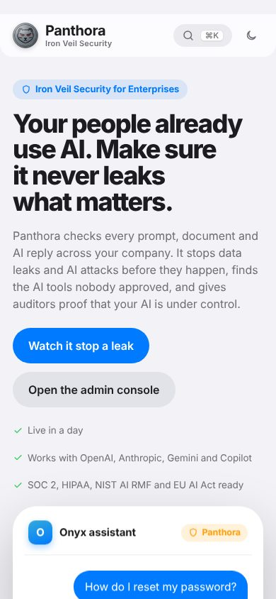
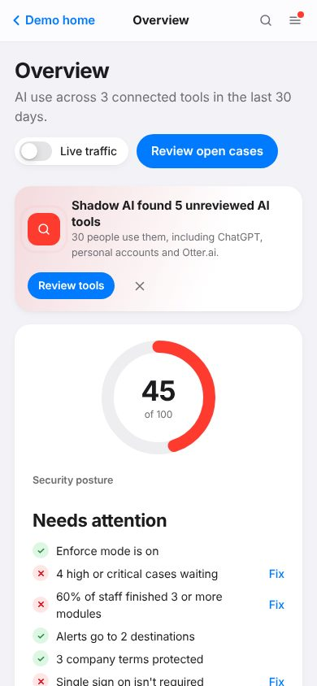
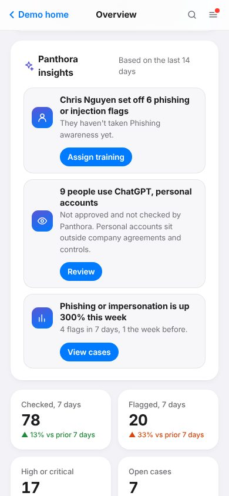

# Panthora

**Iron Veil Security for enterprises**

**Live demo:** https://panthora.netlify.app  
**Status:** Prototype · **Built at:** Personal

  

## Overview
PantherAssist, generalized into a product for any company. Panthora checks every prompt, document and AI reply across a business, stops data leaks and AI attacks before they happen, finds AI tools nobody approved, and gives auditors proof that AI is under control.

## What I built
A product site with a live “watch it stop a leak” demo and an admin console: an AI security posture score, open cases, shadow AI findings, phishing and injection trends, and suggested fixes like assigning training. It is positioned for OpenAI, Anthropic, Gemini and Copilot, and for SOC 2, HIPAA, NIST AI RMF and EU AI Act readiness.

## My role
Solo project: research, UX flows, design and build.

## Security and privacy
* Product demo of AI data leak prevention: screens prompts and replies, flags unapproved AI tools, and tracks readiness for SOC 2, HIPAA, NIST AI RMF and the EU AI Act.
* Ships with strict security headers (`_headers`).

## Tech
HTML, CSS, JavaScript, Claude

## Run it
It is a static site: open `index.html` in a browser, or drag the folder onto Netlify Drop or Vercel.

## What's next
Validate it alongside a small business security checkup offer, then pilot with one company.

---
Built by **Taseyana Booker-Hopkins** · Computer Information Systems (cybersecurity), Georgia State University · [Portfolio](https://taseyanab.github.io) · [LinkedIn](https://linkedin.com/in/taseyana)
